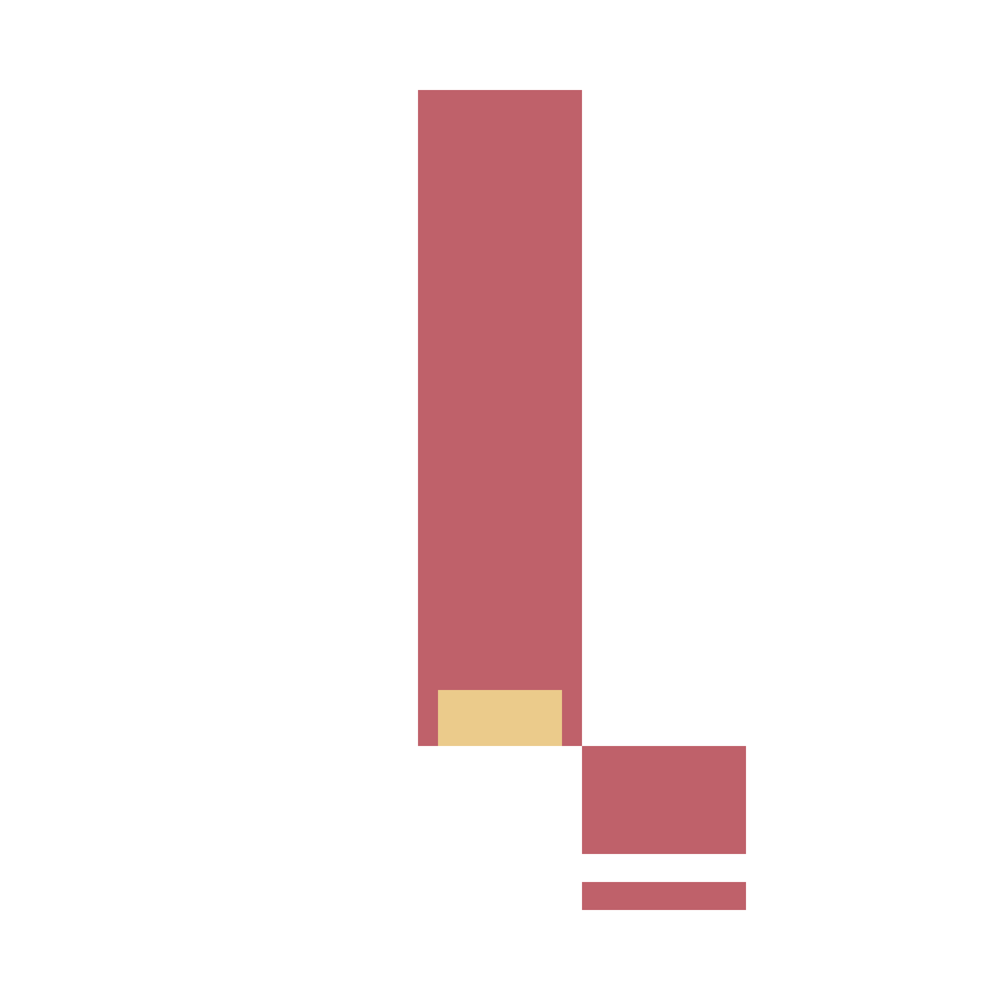

<h1>Levelecture</h1>

  

Levelecture is a personal course and assignment tracker for college students: manage courses, keep deadlines and priorities in check, record grades, and see progress at a glance.

Built with SvelteKit, it favors a fast, no-nonsense UX: edit assignments inline, filter and search in place, and see progress update immediately — no unnecessary steps. The whole workflow lives in one app: course management, assignment tracking, a status pie, and a grades chart.

## Contributing

We welcome contributions!

For new features or significant changes, open an issue first instead of a PR. Describe the problem, your proposed approach, and why it belongs in Levelecture.

- [`CONTRIBUTING.md`](./CONTRIBUTING.md) — setup
- [Pull request template](./.github/pull_request_template.md)
- [Bug report](./.github/ISSUE_TEMPLATE/bug_report.md) / [Feature request](./.github/ISSUE_TEMPLATE/feature_request.md)

## License

This project is licensed under the AGPL-3.0 License. 